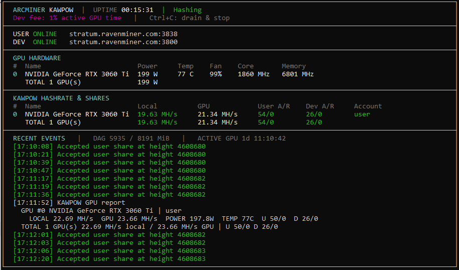

# Arcminer

 

Arcminer is an cryptocurrency miner for Windows PCs with an NVIDIA CUDA GPU. It runs in the foreground, so you choose when to start and stop it. It currently mines on **one GPU per process**.

**Developer fee:** Arcminer uses **1% of active GPU hashing time** for a separate developer pool account. This is time spent hashing, not 1% of your rewards. The dashboard shows the active account and fee time.

## Get mining

1. Extract the Windows release ZIP. Keep `arcminer.exe` and the included DLLs together.
2. Pick a coin launcher in the ZIP: `rvn.bat`, `abrs.bat`, `ergo.bat`, `etc.bat`, `mew.bat`, or `xna.bat`.
3. Open the launcher in a text editor and replace `[WALLET ADDRESS]` with **your own address for that coin**. Save the file.
4. Run the launcher. Press **Ctrl+C** in the miner window to stop cleanly.

You need a compatible NVIDIA GPU and driver. A CUDA Toolkit and Visual Studio are only needed if you build Arcminer yourself. If your wallet address is invalid, Arcminer will refuse to start. The current download ZIPs are still v1.0.1; v1.0.2 packages have not been uploaded yet.

### Run from PowerShell instead

From the folder containing `arcminer.exe`, this example starts Ravencoin mining. Replace the wallet address before running it:

```powershell
.\arcminer.exe --mine --coin rvn --pool stratum+tcp://stratum.ravenminer.com:3800 --wallet YOUR_RVN_ADDRESS --worker ArcWorker1
```

`--mine` starts foreground hashing. Run `.\arcminer.exe --list-devices` to see your GPUs, then add `--devices 0` if you need to choose one. Run `.\arcminer.exe --help` for all options.

## Coins you can choose

| Coin | Algorithm | Status |
| --- | --- | --- |
| Ravencoin (RVN) | KawPoW | GPU shares accepted; CPU mode unverified |
| Aurora Borealis Coin (ABRS) | KawPoW | Mainnet shares accepted |
| Ergo (ERG) | Autolykos v2 | Mainnet shares accepted |
| Ethereum Classic (ETC) | Etchash | Mainnet shares accepted |
| Meowcoin (MEWC) | MeowPoW | Mainnet share accepted |
| Alephium (ALPH) | Alephium | Mainnet share accepted |
| Zent Cash (ZTC) | Chukwa | Mainnet share accepted |
| Neurai (XNA) | KawPoW | Live share acceptance unverified |
| Neoxa (NEOX) | KawPoW | Live share acceptance unverified |
| Karlsen (KLS) | KarlsenHashV2 | Live share acceptance unverified |

Use a launcher included in your ZIP or a supported `--coin` value. ZTC's Windows launcher is in the v1.0.2 source but is not in the current ZIPs. KpowBIT (KPOW) supports configuration checking only; mining is unavailable. Other coins in the [technical notes](README-TECHNICAL.md) are planned or under development.

The v1.0.2 source adds RVN CPU mining (`--processor cpu`) and combined CPU/GPU mining (`--processor both`). Windows KawPoW and MeowPoW also support secure pool connections. These features require a v1.0.2 build.

## What to expect

The dashboard shows your pool connection, accepted and rejected shares, GPU activity, and the developer account. A share may take time to appear. Arcminer checks candidate hashes on the CPU before submitting them.

Arcminer pauses between batches when the GPU reaches 80 °C and stops hashing above 85 °C. It requires a working temperature reading. Optional clock and power controls are described in [GPU tuning notes](GPU-TUNING.md); leave them off unless you intend to change your GPU settings.

Keep Arcminer's `.fee-state` file between runs so active hashing time carries over. Arcminer prints its location when mining starts. Use **Ctrl+C** to let it finish its current batch and save the state.

Arcminer is still experimental. Live shares have been accepted only where the table says so, and the miner has not been validated on every GPU, driver, or pool. Use it only on a device you are authorized to mine with.

## More information

- [Detailed project and development notes](README-TECHNICAL.md)
- [Bitcointalk discussion](https://bitcointalk.org/index.php?topic=5598698.new#new)
- [Join the ArcMiner Discord](https://discord.gg/4QNGABKPaK)


 
