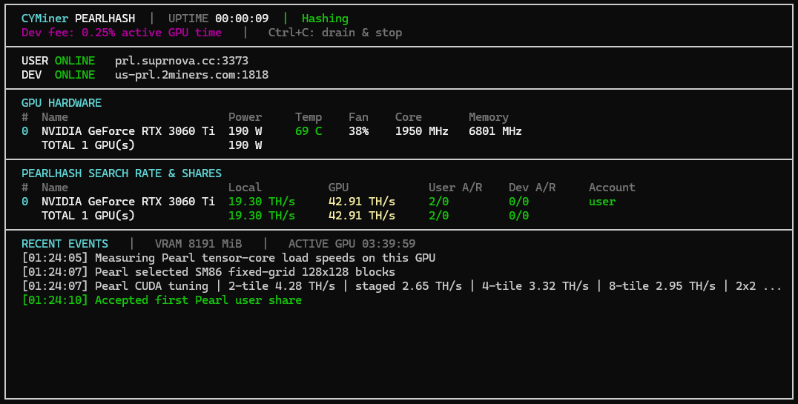

# CYMiner downloads



CYMiner is an experimental, opt-in cryptocurrency miner for Windows PCs with an NVIDIA CUDA GPU. It runs in the foreground, so you choose when to start and stop it. It currently mines on **one GPU per process**.

**Developer fee:** CYMiner allocates **1% of active hashing time** to a separate developer pool account on standard routes. The packaged Windows Pearl route reports **0.25% of active GPU hashing time**. The fee is measured in hashing time. The dashboard shows the active account and fee time.

## Downloads

The release repository hosts the [Windows x64 CUDA ZIP](https://raw.githubusercontent.com/arcminer27/arcminer/main/release/latest/cyminer-windows-x64-standalone.zip) and [experimental Linux x64 CUDA ZIP](https://raw.githubusercontent.com/arcminer27/arcminer/main/release/latest/cyminer-linux-x64-cuda-experimental.zip). These are the v1.0.4 packages. Use `cyminer.exe` on Windows and `cyminer` on Linux. See the [v1.0.4 release notes](RELEASE.md#v104).

## Get mining

1. Extract the Windows release ZIP. Keep `cyminer.exe` and the included DLLs together.
2. Pick a coin launcher in the ZIP: `rvn.bat`, `abrs.bat`, `ergo.bat`, `etc.bat`, `mew.bat`, `xna.bat`, or `ztc.bat`.
3. Open the launcher in a text editor and replace `[WALLET ADDRESS]` with **your own address for that coin**. For `ztc.bat`, replace `[YOUR ZTC ADDRESS]`. Save the file.
4. Run the launcher. Press **Ctrl+C** in the miner window to stop cleanly.

You need a compatible NVIDIA GPU and driver. A CUDA Toolkit and Visual Studio are only needed if you build CYMiner yourself. If your wallet address is invalid, CYMiner will refuse to start.

### Run from PowerShell instead

From the folder containing `cyminer.exe`, this example starts Ravencoin mining. Replace the wallet address before running it:

```powershell
.\cyminer.exe --mine --coin rvn --pool stratum+tcp://stratum.ravenminer.com:3800 --wallet YOUR_RVN_ADDRESS --worker ArcWorker1
```

`--mine` starts foreground hashing. Run `.\cyminer.exe --list-devices` to see your GPUs, then add `--devices 0` if you need to choose one. Run `.\cyminer.exe --help` for all options.

## Coins you can choose

| Coin | Algorithm | Status |
| --- | --- | --- |
| Ravencoin (RVN) | KawPoW | GPU shares accepted; CPU mode unverified |
| Aurora Borealis Coin (ABRS) | KawPoW | Mainnet shares accepted |
| Ergo (ERG) | Autolykos v2 | Mainnet shares accepted |
| Ethereum Classic (ETC) | Etchash | Mainnet shares accepted |
| Meowcoin (MEWC) | MeowPoW | Mainnet share accepted |
| Alephium (ALPH) | Alephium | Mainnet share accepted |
| Zent Cash (ZTC) | Chukwa | Mainnet share accepted |
| Neurai (XNA) | KawPoW | Live share acceptance unverified |
| Neoxa (NEOX) | KawPoW | Live share acceptance unverified |
| Karlsen (KLS) | KarlsenHashV2 | Experimental GPU route. Live share acceptance unverified |
| Kaspa (KAS) | kHeavyHash | Experimental GPU route. Live share acceptance unverified |
| Zano (ZANO) | ProgPoWZ | Experimental GPU route. Live share acceptance unverified |
| Pearl (PRL) | PearlHash | Experimental Windows CUDA on Suprnova. Source testing recorded a CPU-verified share accepted by Suprnova |
| Zephyr Protocol (ZEPH) | RandomX | Experimental single-thread Windows CPU mining. Live share acceptance unverified |
| Monero (XMR) | RandomX | Offline CPU configuration check only |

Use an included launcher or check `--help` for coin options on your platform. The Windows package lists `karlsen`, `kaspa`, `zano`, and `prl` as coin values. For ZEPH CPU mining, add `--coin zeph --processor cpu --experimental-randomx` to an explicit `--mine` command with your pool and wallet. For XMR, use `--check-config --coin xmr --processor cpu` with your pool and wallet. KpowBIT (KPOW) supports configuration checking only; mining is unavailable. Other coins in the [technical notes](README-TECHNICAL.md) are planned or under development.

The release notes document RVN CPU mining (`--processor cpu`) and combined CPU/GPU mining (`--processor both`). Windows KawPoW and MeowPoW also support secure pool connections.

## What to expect

The dashboard shows your pool connection, accepted and rejected shares, GPU activity, and the developer account. A share may take time to appear. CYMiner checks candidate hashes on the CPU before submitting them.

CYMiner pauses between batches when the GPU reaches 80 °C and stops hashing above 85 °C. It requires a working temperature reading. Optional clock and power controls are described in [GPU tuning notes](GPU-TUNING.md); leave them off unless you intend to change your GPU settings.

Keep CYMiner's `.fee-state` file between runs so active hashing time carries over. CYMiner prints its location when mining starts. Use **Ctrl+C** to let it finish its current batch and save the state.

CYMiner is still experimental. Live shares have been accepted only where the table says so, and the miner has not been validated on every GPU, driver, or pool. Use it only on a device you are authorized to mine with.

## More information

- [Detailed project and development notes](README-TECHNICAL.md)
- [Bitcointalk discussion](https://bitcointalk.org/index.php?topic=5598698.new#new)
- [Join the CYMiner Discord](https://discord.gg/4QNGABKPaK)


 
